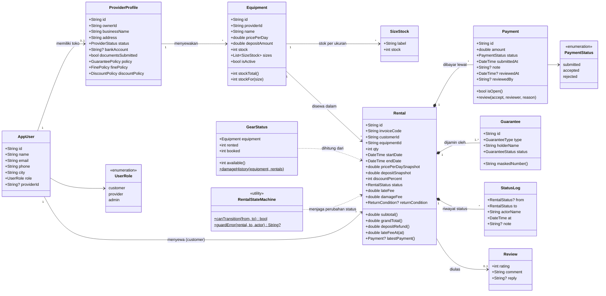
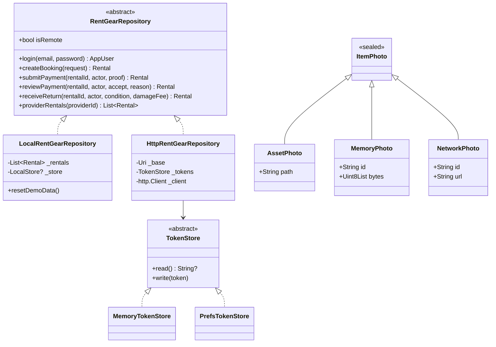

# Bagian 9: Diagram kelas dan penerapan PBO

Dokumen ini memetakan kelas di kode ke rancangan Customer, Gear, Rental, dan Payment, lalu menunjukkan di mana empat
prinsip PBO dipakai. Nama berkas di bawah bisa dibuka langsung di repositori. Semua kelas yang disebut ada di kode
per 21 Oktober 2026.

## 1. Pemetaan nama kelas

Kode memakai nama bahasa Inggris yang lebih umum. Isinya sama dengan kelas di tabel penilaian.

| Kelas di tabel | Kelas di aplikasi (Dart) | Kelas di server (PHP) |
|---|---|---|
| Customer | `AppUser` dengan `role = UserRole.customer` (`rentgear_app/lib/domain/models.dart`) | `User` dengan `role = 'customer'` (`rentgear_api/app/Models/User.php`) |
| Gear | `Equipment` dan `SizeStock` (`models.dart`) | `Equipment` dan `EquipmentSize` (`app/Models/Equipment.php`) |
| Rental | `Rental` dan `StatusLog` (`models.dart`) | `Rental` dan `RentalStatusLog` (`app/Models/Rental.php`) |
| Payment | `Payment` dan `PaymentStatus` (`models.dart`) | `Payment` (`app/Models/Payment.php`, tabel `payments`) |

Customer tidak dibuat sebagai kelas terpisah karena penyewa, penyedia, dan admin berbagi data akun yang sama (nama,
email, nomor HP, kota). Bedanya hanya peran, jadi peran disimpan sebagai enum `UserRole`. Data toko milik penyedia ada
di kelas tersendiri, `ProviderProfile`.

## 2. Diagram kelas inti

Relasi dengan belah ketupat penuh (`*--`) berarti komposisi: pembayaran, jaminan, dan riwayat status tidak punya arti
tanpa sewanya. Garis putus-putus berarti kelas itu hanya memakai kelas lain untuk menghitung atau memeriksa.

## 3. Lapisan data: abstraksi dan polimorfisme

Layar aplikasi tidak tahu dari mana data datang. Semua layar memanggil kontrak `RentGearRepository`, dan ada dua
implementasi yang bisa ditukar tanpa mengubah layar.

`RentGearRepository` punya 58 metode; diagram hanya menampilkan beberapa yang berkaitan dengan sewa dan
pembayaran.

## 4. Empat prinsip PBO di kode

### Enkapsulasi

- `Payment.review()` adalah satu-satunya jalan untuk mengubah status pembayaran. Metode itu menolak bila bukti sudah
  pernah diperiksa (`models.dart`, kelas `Payment`; versi server di `app/Models/Payment.php`).
- Harga sewa dihitung di dalam `Rental` lewat getter `subtotal`, `discount`, `grandTotal`, dan `depositRefund`. Layar
  hanya membaca hasilnya, tidak menghitung sendiri.
- `Guarantee` menyimpan nomor dokumen, tetapi layar menampilkan `maskedNumber`, jadi nomor lengkap tidak pernah tampil.
- Di server, NIK pemilik toko dan nomor jaminan disimpan dengan cast `encrypted`, sehingga kode lain tidak bisa
  membaca nilai mentahnya dari database.
- Field internal repository lokal diberi awalan `_` (mis. `_rentals`, `_store`), sehingga hanya bisa diubah lewat
  metode publiknya.

### Abstraksi

- `RentGearRepository` (`rentgear_app/lib/data/repository.dart`) adalah kelas abstrak yang hanya berisi kontrak.
- `TokenStore` (`http_repository.dart`) menyembunyikan tempat token disimpan: di memori untuk tes, di
  `SharedPreferences` untuk aplikasi.
- `RentalStateMachine` menyembunyikan tabel perubahan status yang sah. Pemanggil cukup bertanya `canTransition`.

### Pewarisan

- `AssetPhoto`, `MemoryPhoto`, dan `NetworkPhoto` mewarisi `sealed class ItemPhoto` (`models.dart`).
- Di server, semua model mewarisi `Illuminate\Database\Eloquent\Model`, dan `User` mewarisi `Authenticatable`. Trait
  `HasStringId` dipakai ulang oleh `Rental`, `Payment`, `Equipment`, dan `Provider` untuk membuat id ULID.

### Polimorfisme

- `LocalRentGearRepository` dan `HttpRentGearRepository` sama-sama mengimplementasikan `RentGearRepository`. `AppState`
  memegang tipe abstraknya, dan pilihan implementasi dibuat sekali di `main.dart` berdasarkan `API_URL`.
- `ItemPhotoView` (`rentgear_app/lib/widgets/photo_widgets.dart`) memakai `switch` atas `ItemPhoto`. Kompiler
  memastikan ketiga subkelas ditangani, dan tiap subkelas ditampilkan dengan cara sendiri (`Image.asset`,
  `Image.memory`, `Image.network`).
- Enum seperti `RentalStatus`, `PaymentStatus`, dan `ReturnCondition` membawa `label` masing-masing, sehingga layar
  menampilkan teks yang benar tanpa `if` bertingkat.

## 5. Kelas di server

Server Laravel memakai pola yang sama: model Eloquent untuk data, dan service untuk aturan bisnis.

| Kelas | Tanggung jawab |
|---|---|
| `User`, `Provider`, `Equipment`, `Rental`, `Payment`, `Guarantee` | Model data. `Rental::amountDue()` menghitung nominal transfer; `Payment::review()` memutuskan bukti. |
| `BookingService` | Membuat booking: kunci harga, cek stok (ALG-2), simpan jaminan, Idempotency-Key. |
| `RentalFlowService` | Semua perubahan status setelah booking: konfirmasi, pembayaran, serah terima, pengembalian, denda. |
| `StoreVerificationService` | Buka toko, kirim dokumen, dan keputusan admin atas toko. |
| `RentalStateMachine`, `PriceCalculator`, `DiscountPolicy`, `FinePolicy` | Aturan murni tanpa database, sama dengan versi Dart. |
