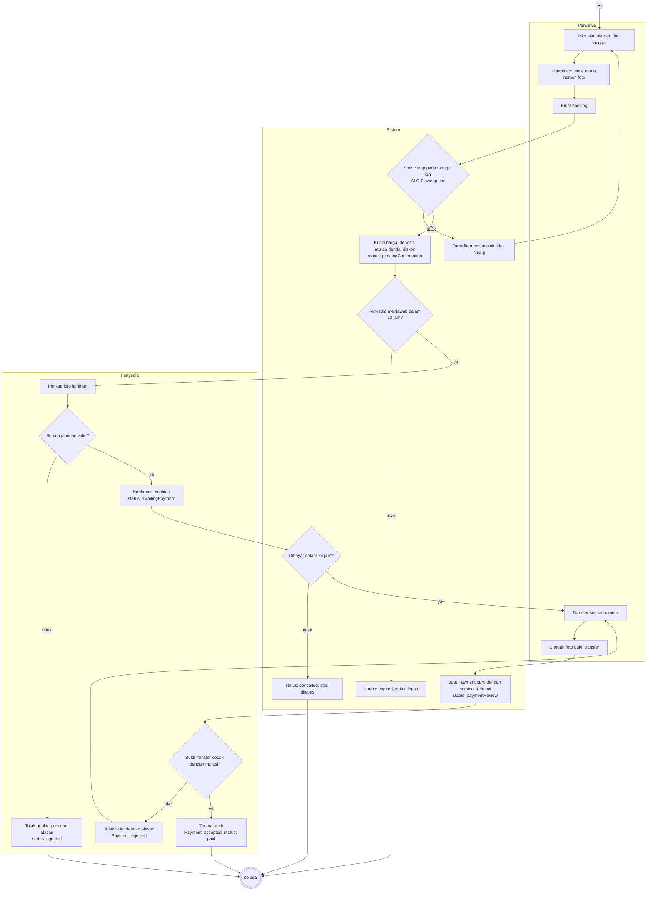
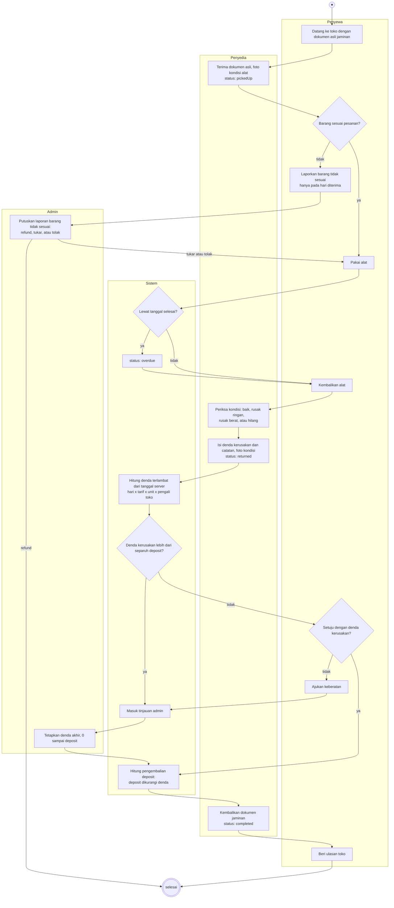
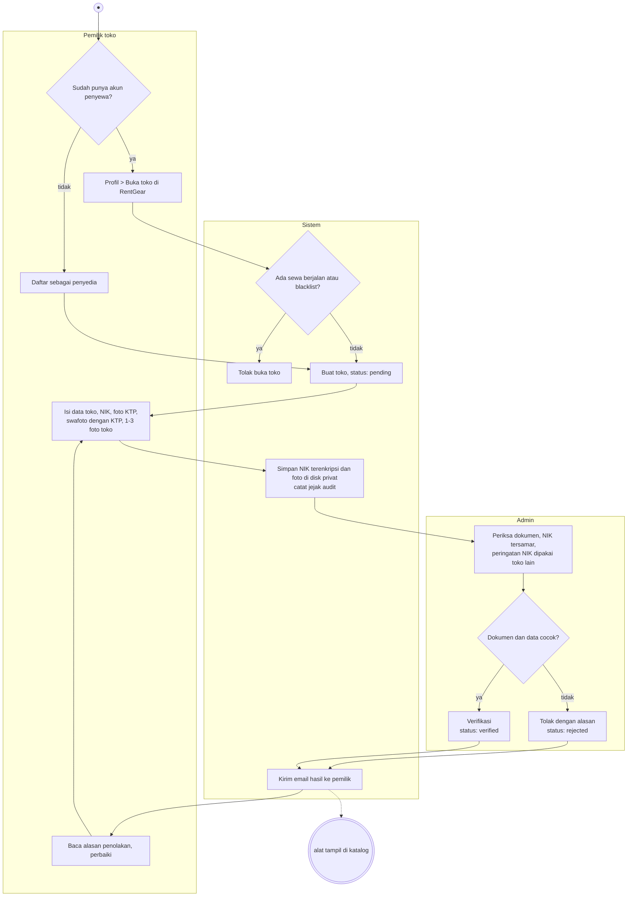
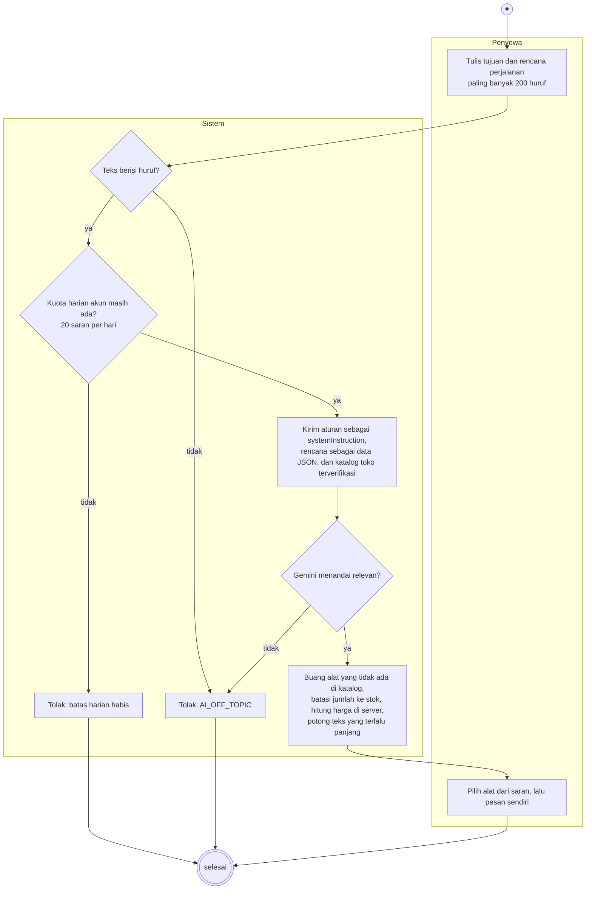

# Bagian 10: Activity diagram

Diagram di bawah menggambarkan alur yang benar-benar berjalan di aplikasi per 21 Oktober 2026, bukan rancangan awal di
Bagian 3. Tiap kolom (swimlane) adalah satu pelaku: penyewa, sistem (server RentGear), penyedia, atau admin. Lingkaran
hitam adalah titik mulai, dan lingkaran bergaris ganda adalah titik selesai. Belah ketupat adalah keputusan.

Mermaid belum punya jenis activity diagram UML, jadi swimlane digambar dengan `subgraph`. Nama status di kurung siku
sama dengan nilai `RentalStatus` di kode.

## 1. Pemesanan dan pembayaran

Catatan:

- Booking yang dikirim dua kali dengan `Idempotency-Key` yang sama hanya tercatat satu kali.
- Booking yang datang bersamaan untuk unit terakhir mengantre di database (transaksi `IMMEDIATE`). Satu berhasil, yang
  lain mendapat pesan stok tidak cukup. Hasil ujinya ada di Bagian 11.
- Bukti transfer yang ditolak tetap tersimpan sebagai `Payment` berstatus `rejected`, jadi riwayatnya bisa dilihat.

## 2. Serah terima, pengembalian, dan denda

Catatan:

- Penyedia tidak bisa menutup transaksi selama denda masih ditinjau admin (`DAMAGE_REVIEW_PENDING`).
- Pengembalian dengan kondisi selain baik muncul di "Catatan kerusakan" pada form alat, sebagai riwayat kerusakan per
  alat.
- Tiga pelanggaran (terlambat, tidak datang, rusak) membuat penyewa masuk blacklist otomatis.

## 3. Pendaftaran dan verifikasi toko

Admin tidak bisa memverifikasi toko yang belum mengirim dokumen. Garis putus-putus berarti alat baru tampil setelah
status toko `verified`.

## 4. Saran paket alat dari AI

